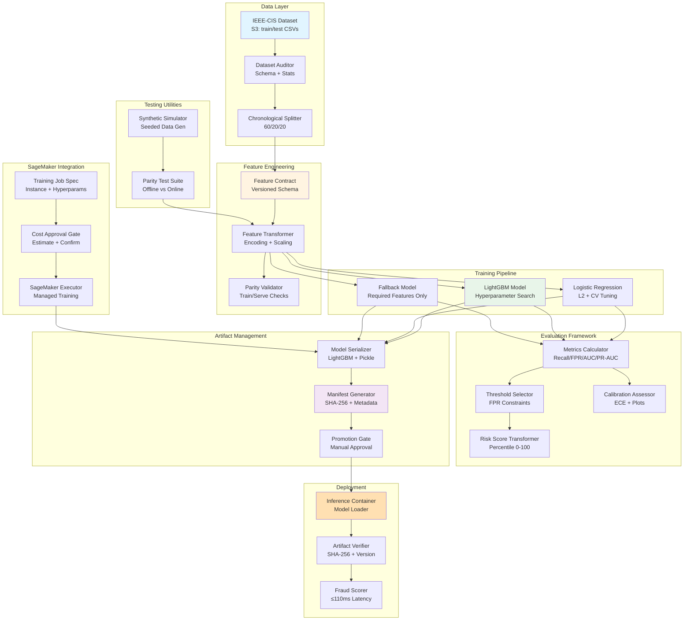

# Design Document: ML Model Training and Evaluation Pipeline

## Overview

The ML Model Training and Evaluation Pipeline is a comprehensive system for developing, validating, and deploying fraud detection models on the IEEE-CIS transaction dataset. The pipeline enforces strict data hygiene (chronological splits, no train/test leakage), supports reproducible training via AWS SageMaker, and produces versioned model artifacts optimized for CPU-based inference with ≤110ms latency.

### Design Philosophy

1. **Reproducibility First**: All stochastic operations are seeded; dependencies are pinned; data provenance is tracked via SHA-256 hashes
2. **Fail-Safe by Default**: Explicit approval gates for cost and promotion; cryptographic verification of artifacts; version compatibility checks
3. **Offline/Online Parity**: Feature transformations are identical between training and inference to prevent serving skew
4. **Graceful Degradation**: Fallback models handle partial feature availability without rejecting transactions
5. **Auditability**: Comprehensive manifests track training data, hyperparameters, metrics, and approval decisions

### Key Technical Decisions

Based on requirements analysis and research:

- **GBT Framework**: **LightGBM** (selected over XGBoost for superior inference latency control based on [ResearchSquare comparative study](https://www.researchsquare.com/article/rs-7539803/v1.pdf))
- **Categorical Encoding**: **Target encoding** for tree-based models (optimal for GBT per [arXiv:2401.09682](https://arxiv.org/html/2401.09682v1/)), **one-hot encoding** for logistic regression baseline
- **Class Imbalance**: Inverse frequency class weights + optional SMOTE oversampling (effective per [arXiv:2406.04658](https://arxiv.org/html/2406.04658v3))
- **Feature Contract Versioning**: Semantic versioning (MAJOR.MINOR.PATCH) with compatibility rules
- **Inference Optimization**: Max 500 trees × 31 leaves to meet latency budget on ml.m5.2xlarge CPUs


## Architecture

### High-Level System Components



### Component Interactions

1. **Data Preparation Flow**: IEEE-CIS CSVs → Audit (schema + stats) → Chronological Split → Feature Contract Definition
2. **Training Flow**: Split Data → Feature Transform → Model Training (Baseline/GBT/Fallback) → Evaluation → Artifact Serialization
3. **SageMaker Flow**: Job Configuration → Cost Approval → Execution → Artifact Output to S3
4. **Deployment Flow**: Artifact Download → SHA-256 Verification → Version Compatibility Check → Model Loading → Inference Serving
5. **Testing Flow**: Synthetic Simulator → Parity Test (Offline vs Online) → Feature Transform Validation


## Data Management Layer

### Dataset Audit Component

**Purpose**: Document IEEE-CIS dataset structure, feature statistics, and temporal characteristics before training.

**Implementation**:

```python
class DatasetAuditor:
    """Audit IEEE-CIS dataset and generate Dataset Card."""
    
    def audit(self, transaction_path: str, identity_path: str) -> DatasetCard:
        """
        Generate comprehensive dataset documentation.
        
        Returns:
            DatasetCard with schema, statistics, and temporal info
        """
        # Load data
        transactions = pd.read_csv(transaction_path)
        identity = pd.read_csv(identity_path)
        
        # Verify join integrity
        assert identity['TransactionID'].isin(transactions['TransactionID']).all()
        
        # Compute statistics
        card = DatasetCard(
            transaction_columns=self._get_schema(transactions),
            identity_columns=self._get_schema(identity),
            join_key='TransactionID',
            fraud_rate=transactions['isFraud'].mean(),
            temporal_column='TransactionDT',
            temporal_range=(transactions['TransactionDT'].min(), 
                          transactions['TransactionDT'].max()),
            missingness_rates=self._compute_missingness(transactions, identity),
            feature_types=self._classify_features(transactions, identity)
        )
        
        return card
```

**Dataset Card Schema**:

```python
@dataclass
class DatasetCard:
    transaction_columns: List[ColumnSchema]
    identity_columns: List[ColumnSchema]
    join_key: str
    fraud_rate: float
    temporal_column: str
    temporal_range: Tuple[float, float]
    missingness_rates: Dict[str, float]
    feature_types: Dict[str, FeatureType]  # CATEGORICAL | NUMERIC
    excluded_features: List[ExcludedFeature]  # From leakage audit
    
@dataclass
class ColumnSchema:
    name: str
    dtype: str
    cardinality: Optional[int]  # For categoricals
    numeric_range: Optional[Tuple[float, float]]  # For numerics
```

**Leakage Audit**:

- Scan for features with names suggesting future information (e.g., "DaysUntil...", "Future...")
- Flag aggregation features that don't specify temporal boundaries
- Exclude flagged features from Feature Contract with documented justification
- Output: `excluded_features` list in Dataset Card

### Chronological Splitter

**Purpose**: Create train/validation/test splits ordered by TransactionDT to prevent temporal leakage.

**Algorithm**:

```python
class ChronologicalSplitter:
    """Split data chronologically for realistic evaluation."""
    
    def split(
        self, 
        data: pd.DataFrame, 
        train_pct: float = 0.6,
        val_pct: float = 0.2,
        test_pct: float = 0.2,
        temporal_column: str = 'TransactionDT',
        seed: int = 42
    ) -> ChronologicalSplit:
        """
        Partition sorted data into train/val/test.
        
        Returns:
            ChronologicalSplit with transaction IDs for each set
        """
        assert abs(train_pct + val_pct + test_pct - 1.0) < 1e-6
        
        # Sort by temporal column
        sorted_data = data.sort_values(temporal_column).reset_index(drop=True)
        
        # Compute split indices
        n = len(sorted_data)
        train_end = int(n * train_pct)
        val_end = train_end + int(n * val_pct)
        
        # Extract transaction IDs
        train_ids = sorted_data.iloc[:train_end]['TransactionID'].tolist()
        val_ids = sorted_data.iloc[train_end:val_end]['TransactionID'].tolist()
        test_ids = sorted_data.iloc[val_end:]['TransactionID'].tolist()
        
        # Verify temporal ordering
        train_max_time = sorted_data.iloc[train_end - 1][temporal_column]
        val_min_time = sorted_data.iloc[train_end][temporal_column]
        val_max_time = sorted_data.iloc[val_end - 1][temporal_column]
        test_min_time = sorted_data.iloc[val_end][temporal_column]
        
        assert train_max_time <= val_min_time
        assert val_max_time <= test_min_time
        
        return ChronologicalSplit(
            train_ids=train_ids,
            val_ids=val_ids,
            test_ids=test_ids,
            train_pct=train_pct,
            val_pct=val_pct,
            test_pct=test_pct,
            seed=seed,
            temporal_boundaries={
                'train_range': (sorted_data.iloc[0][temporal_column], train_max_time),
                'val_range': (val_min_time, val_max_time),
                'test_range': (test_min_time, sorted_data.iloc[-1][temporal_column])
            }
        )
```

**Persistence**:

- Save split transaction IDs to `splits/train_ids.txt`, `splits/val_ids.txt`, `splits/test_ids.txt`
- Include split metadata (percentages, seed, temporal boundaries) in manifest
- Enable reproducible experiments by loading saved split IDs


## Feature Engineering

### Feature Contract Schema

**Purpose**: Define versioned schema for feature names, types, transformations, and offline/online parity requirements.

**Schema Structure**:

```python
@dataclass
class FeatureContract:
    version: str  # Semantic version: MAJOR.MINOR.PATCH
    features: List[FeatureDefinition]
    metadata: ContractMetadata
    
@dataclass
class FeatureDefinition:
    name: str
    source_column: str  # Original column name from IEEE dataset
    feature_type: FeatureType  # CATEGORICAL | NUMERIC
    required: bool  # True = required for inference, False = optional
    
    # Missingness handling
    missingness_strategy: MissingnessStrategy  # IMPUTE | DROP | INDICATOR
    imputation_method: Optional[ImputationMethod]  # MEAN | MEDIAN | MODE | CONSTANT
    imputation_value: Optional[Any]  # For CONSTANT imputation
    
    # Categorical encoding
    encoding_scheme: Optional[EncodingScheme]  # TARGET | ONEHOT | HASH | ORDINAL
    encoding_params: Optional[Dict[str, Any]]  # E.g., target encoding smoothing
    
    # Numeric scaling
    scaling_method: Optional[ScalingMethod]  # STANDARD | MINMAX | NONE
    scaling_params: Optional[Dict[str, Any]]  # E.g., fitted mean/std for standardization
    
@dataclass
class ContractMetadata:
    created_at: str  # ISO 8601 timestamp
    git_commit: str
    dataset_version: str
    description: str

# Enums
class FeatureType(Enum):
    CATEGORICAL = "categorical"
    NUMERIC = "numeric"

class MissingnessStrategy(Enum):
    IMPUTE = "impute"
    DROP = "drop"
    INDICATOR = "indicator"

class ImputationMethod(Enum):
    MEAN = "mean"
    MEDIAN = "median"
    MODE = "mode"
    CONSTANT = "constant"

class EncodingScheme(Enum):
    TARGET = "target"  # Target encoding (for GBT)
    ONEHOT = "onehot"  # One-hot encoding (for baseline)
    HASH = "hash"      # Feature hashing
    ORDINAL = "ordinal"  # Ordinal encoding

class ScalingMethod(Enum):
    STANDARD = "standard"  # Z-score normalization
    MINMAX = "minmax"      # Min-max scaling to [0, 1]
    NONE = "none"          # No scaling
```

**Versioning Rules**:

- **MAJOR**: Increment when feature contract is incompatible (features removed, types changed)
- **MINOR**: Increment when features added or encoding schemes modified
- **PATCH**: Increment when documentation or metadata updated

**Example Contract**:

```json
{
  "version": "1.0.0",
  "features": [
    {
      "name": "TransactionAmt_scaled",
      "source_column": "TransactionAmt",
      "feature_type": "numeric",
      "required": true,
      "missingness_strategy": "impute",
      "imputation_method": "median",
      "imputation_value": null,
      "encoding_scheme": null,
      "encoding_params": null,
      "scaling_method": "standard",
      "scaling_params": {"mean": 100.5, "std": 150.2}
    },
    {
      "name": "ProductCD_encoded",
      "source_column": "ProductCD",
      "feature_type": "categorical",
      "required": true,
      "missingness_strategy": "impute",
      "imputation_method": "mode",
      "imputation_value": "W",
      "encoding_scheme": "target",
      "encoding_params": {"smoothing": 10.0},
      "scaling_method": null,
      "scaling_params": null
    },
    {
      "name": "card1_encoded",
      "source_column": "card1",
      "feature_type": "categorical",
      "required": false,
      "missingness_strategy": "indicator",
      "imputation_method": null,
      "imputation_value": null,
      "encoding_scheme": "target",
      "encoding_params": {"smoothing": 10.0},
      "scaling_method": null,
      "scaling_params": null
    }
  ],
  "metadata": {
    "created_at": "2025-01-15T10:30:00Z",
    "git_commit": "a1b2c3d4",
    "dataset_version": "ieee-cis-2019",
    "description": "Initial feature contract for fraud detection"
  }
}
```

### Feature Transformer

**Purpose**: Apply feature transformations consistently for training and inference.

**Implementation**:

```python
class FeatureTransformer:
    """Transform raw transactions according to Feature Contract."""
    
    def __init__(self, contract: FeatureContract, fit_mode: bool = True):
        self.contract = contract
        self.fit_mode = fit_mode
        self.fitted_params = {}  # Store fitted statistics for scaling/encoding
        
    def fit_transform(self, data: pd.DataFrame) -> pd.DataFrame:
        """Fit transformation parameters on training data and transform."""
        assert self.fit_mode, "Cannot fit in non-fit mode"
        
        transformed = pd.DataFrame(index=data.index)
        
        for feature_def in self.contract.features:
            # Extract source column
            source_col = data[feature_def.source_column]
            
            # Handle missingness
            source_col = self._handle_missingness(
                source_col, feature_def, fit=True
            )
            
            # Apply encoding/scaling
            if feature_def.feature_type == FeatureType.CATEGORICAL:
                transformed_col = self._encode_categorical(
                    source_col, feature_def, fit=True
                )
            else:
                transformed_col = self._scale_numeric(
                    source_col, feature_def, fit=True
                )
            
            transformed[feature_def.name] = transformed_col
        
        return transformed
    
    def transform(self, data: pd.DataFrame) -> pd.DataFrame:
        """Transform using fitted parameters (inference mode)."""
        transformed = pd.DataFrame(index=data.index)
        
        for feature_def in self.contract.features:
            source_col = data.get(feature_def.source_column)
            
            if source_col is None and not feature_def.required:
                # Optional feature missing, use default
                transformed[feature_def.name] = self._default_value(feature_def)
                continue
            elif source_col is None and feature_def.required:
                raise ValueError(f"Required feature {feature_def.source_column} missing")
            
            # Apply transformations using fitted params
            source_col = self._handle_missingness(source_col, feature_def, fit=False)
            
            if feature_def.feature_type == FeatureType.CATEGORICAL:
                transformed_col = self._encode_categorical(
                    source_col, feature_def, fit=False
                )
            else:
                transformed_col = self._scale_numeric(
                    source_col, feature_def, fit=False
                )
            
            transformed[feature_def.name] = transformed_col
        
        return transformed
    
    def _encode_categorical(
        self, col: pd.Series, feature_def: FeatureDefinition, fit: bool
    ) -> pd.Series:
        """Apply categorical encoding."""
        if feature_def.encoding_scheme == EncodingScheme.TARGET:
            return self._target_encode(col, feature_def, fit)
        elif feature_def.encoding_scheme == EncodingScheme.ONEHOT:
            return self._onehot_encode(col, feature_def, fit)
        elif feature_def.encoding_scheme == EncodingScheme.HASH:
            return self._hash_encode(col, feature_def)
        else:
            raise ValueError(f"Unsupported encoding: {feature_def.encoding_scheme}")
    
    def _target_encode(
        self, col: pd.Series, feature_def: FeatureDefinition, fit: bool
    ) -> pd.Series:
        """Target encoding with smoothing (optimal for tree-based models)."""
        key = f"{feature_def.name}_target_map"
        
        if fit:
            # Compute target encoding map on training data
            # This requires access to labels, passed separately during fit
            smoothing = feature_def.encoding_params.get('smoothing', 1.0)
            global_mean = self.train_labels.mean()
            
            group_stats = self.train_data.groupby(col).agg({
                'isFraud': ['sum', 'count']
            })
            
            # Smoothed target encoding
            target_map = (
                group_stats['isFraud']['sum'] + smoothing * global_mean
            ) / (
                group_stats['isFraud']['count'] + smoothing
            )
            
            self.fitted_params[key] = {
                'map': target_map.to_dict(),
                'global_mean': global_mean
            }
        
        # Apply encoding
        encoding_map = self.fitted_params[key]['map']
        global_mean = self.fitted_params[key]['global_mean']
        
        return col.map(encoding_map).fillna(global_mean)
    
    def _scale_numeric(
        self, col: pd.Series, feature_def: FeatureDefinition, fit: bool
    ) -> pd.Series:
        """Apply numeric scaling."""
        if feature_def.scaling_method == ScalingMethod.STANDARD:
            return self._standardize(col, feature_def, fit)
        elif feature_def.scaling_method == ScalingMethod.MINMAX:
            return self._minmax_scale(col, feature_def, fit)
        elif feature_def.scaling_method == ScalingMethod.NONE:
            return col
        else:
            raise ValueError(f"Unsupported scaling: {feature_def.scaling_method}")
```

### Offline/Online Parity Validation

**Purpose**: Ensure feature transformations produce identical results in training and inference.

**Implementation**:

```python
class ParityValidator:
    """Validate offline/online feature engineering parity."""
    
    def validate(
        self,
        offline_transformer: FeatureTransformer,
        online_transformer: FeatureTransformer,
        sample_transactions: pd.DataFrame,
        tolerance: float = 1e-6
    ) -> ParityReport:
        """
        Compare feature outputs from offline and online transformers.
        
        Args:
            offline_transformer: Training feature transformer
            online_transformer: Inference feature transformer
            sample_transactions: Raw test transactions
            tolerance: Acceptable numeric difference
            
        Returns:
            ParityReport with pass/fail and divergence details
        """
        offline_features = offline_transformer.transform(sample_transactions)
        online_features = online_transformer.transform(sample_transactions)
        
        divergent_features = []
        
        for col in offline_features.columns:
            offline_vals = offline_features[col].values
            online_vals = online_features[col].values
            
            # Check numeric parity
            max_diff = np.abs(offline_vals - online_vals).max()
            
            if max_diff > tolerance:
                divergent_features.append({
                    'feature': col,
                    'max_difference': max_diff,
                    'mean_difference': np.abs(offline_vals - online_vals).mean()
                })
        
        return ParityReport(
            passed=len(divergent_features) == 0,
            divergent_features=divergent_features,
            num_samples_tested=len(sample_transactions)
        )
```


## Training Pipeline

### Baseline Logistic Regression Model

**Purpose**: Provide performance floor and simple fallback for deployment.

**Implementation**:

```python
class BaselineTrainer:
    """Train L2-regularized logistic regression baseline."""
    
    def train(
        self,
        X_train: pd.DataFrame,
        y_train: pd.Series,
        X_val: pd.DataFrame,
        y_val: pd.Series,
        seed: int = 42
    ) -> BaselineModel:
        """
        Train logistic regression with cross-validated regularization.
        
        Returns:
            Trained BaselineModel with fitted estimator
        """
        # Compute class weights for imbalance
        class_weights = compute_class_weight(
            'balanced', classes=np.unique(y_train), y=y_train
        )
        class_weight_dict = {0: class_weights[0], 1: class_weights[1]}
        
        # Hyperparameter search space
        param_grid = {
            'C': [0.001, 0.01, 0.1, 1.0, 10.0],  # Inverse regularization
            'max_iter': [1000]
        }
        
        # Cross-validation on training set
        base_model = LogisticRegression(
            penalty='l2',
            solver='lbfgs',
            class_weight=class_weight_dict,
            random_state=seed
        )
        
        grid_search = GridSearchCV(
            base_model,
            param_grid,
            cv=5,
            scoring='roc_auc',
            n_jobs=-1
        )
        
        grid_search.fit(X_train, y_train)
        
        # Evaluate on validation set
        best_model = grid_search.best_estimator_
        val_probs = best_model.predict_proba(X_val)[:, 1]
        val_auc = roc_auc_score(y_val, val_probs)
        
        return BaselineModel(
            estimator=best_model,
            best_params=grid_search.best_params_,
            val_auc=val_auc,
            class_weights=class_weight_dict
        )
```

**Key Parameters**:
- L2 regularization (penalty='l2')
- C values: [0.001, 0.01, 0.1, 1.0, 10.0]
- Solver: LBFGS (efficient for small datasets)
- Class weights: Inverse frequency balancing

### Gradient Boosted Tree Model (LightGBM)

**Purpose**: Achieve high fraud detection recall while controlling false positive rates.

**Implementation**:

```python
class GBTTrainer:
    """Train LightGBM model with hyperparameter tuning."""
    
    def train(
        self,
        X_train: pd.DataFrame,
        y_train: pd.Series,
        X_val: pd.DataFrame,
        y_val: pd.Series,
        seed: int = 42,
        n_trials: int = 20
    ) -> GBTModel:
        """
        Train LightGBM with Bayesian hyperparameter optimization.
        
        Returns:
            Trained GBTModel with best hyperparameters
        """
        # Compute class weights
        fraud_count = y_train.sum()
        legit_count = len(y_train) - fraud_count
        scale_pos_weight = legit_count / fraud_count
        
        # Define hyperparameter search space
        def objective(trial):
            params = {
                'objective': 'binary',
                'metric': 'auc',
                'verbosity': -1,
                'seed': seed,
                'learning_rate': trial.suggest_float('learning_rate', 0.01, 0.1, log=True),
                'max_depth': trial.suggest_int('max_depth', 3, 7),
                'num_leaves': trial.suggest_int('num_leaves', 7, 31),
                'min_child_samples': trial.suggest_int('min_child_samples', 10, 100),
                'subsample': trial.suggest_float('subsample', 0.6, 1.0),
                'colsample_bytree': trial.suggest_float('colsample_bytree', 0.6, 1.0),
                'scale_pos_weight': scale_pos_weight,
                'n_estimators': 500,  # Max trees for latency constraint
                'max_bin': 255
            }
            
            # Train with early stopping
            model = lgb.LGBMClassifier(**params)
            model.fit(
                X_train, y_train,
                eval_set=[(X_val, y_val)],
                eval_metric='auc',
                callbacks=[
                    lgb.early_stopping(stopping_rounds=50, verbose=False)
                ]
            )
            
            # Evaluate on validation set
            val_probs = model.predict_proba(X_val)[:, 1]
            val_auc = roc_auc_score(y_val, val_probs)
            
            return val_auc
        
        # Run Bayesian optimization
        study = optuna.create_study(direction='maximize', seed=seed)
        study.optimize(objective, n_trials=n_trials)
        
        # Train final model with best params
        best_params = study.best_params
        best_params.update({
            'objective': 'binary',
            'metric': 'auc',
            'verbosity': -1,
            'seed': seed,
            'scale_pos_weight': scale_pos_weight,
            'n_estimators': 500
        })
        
        final_model = lgb.LGBMClassifier(**best_params)
        final_model.fit(
            X_train, y_train,
            eval_set=[(X_val, y_val)],
            eval_metric='auc',
            callbacks=[lgb.early_stopping(stopping_rounds=50, verbose=False)]
        )
        
        return GBTModel(
            estimator=final_model,
            best_params=best_params,
            val_auc=study.best_value,
            n_trees=final_model.n_estimators_,
            optimization_trials=study.trials_dataframe()
        )
```

**Hyperparameter Search Space**:
- `learning_rate`: [0.01, 0.1] (log scale)
- `max_depth`: [3, 7]
- `num_leaves`: [7, 31] (constraint for latency)
- `min_child_samples`: [10, 100]
- `subsample`: [0.6, 1.0]
- `colsample_bytree`: [0.6, 1.0]
- `n_estimators`: 500 (max for ≤110ms latency)

**Early Stopping**: Stop training if validation AUC doesn't improve for 50 rounds.

**Class Imbalance Handling**:
- `scale_pos_weight` = (# legitimate) / (# fraud)
- Optional SMOTE oversampling applied only to training split

### Fallback Model for Partial Features

**Purpose**: Handle transactions with missing optional features via graceful degradation.

**Implementation**:

```python
class FallbackTrainer:
    """Train model on required features only."""
    
    def train(
        self,
        X_train: pd.DataFrame,
        y_train: pd.Series,
        X_val: pd.DataFrame,
        y_val: pd.Series,
        required_features: List[str],
        seed: int = 42
    ) -> FallbackModel:
        """
        Train LightGBM on required features only.
        
        Args:
            required_features: Feature names marked as required in contract
            
        Returns:
            Trained FallbackModel meeting latency and performance thresholds
        """
        X_train_reduced = X_train[required_features]
        X_val_reduced = X_val[required_features]
        
        # Use same GBT trainer but with reduced feature set
        gbt_trainer = GBTTrainer()
        fallback_model = gbt_trainer.train(
            X_train_reduced, y_train,
            X_val_reduced, y_val,
            seed=seed,
            n_trials=10  # Fewer trials for faster training
        )
        
        # Verify minimum performance
        val_probs = fallback_model.estimator.predict_proba(X_val_reduced)[:, 1]
        recall_at_fpr = self._compute_recall_at_fpr(y_val, val_probs, target_fpr=0.01)
        
        if recall_at_fpr < 0.5:
            raise ValueError(
                f"Fallback model does not meet 50% recall at 1% FPR: {recall_at_fpr:.2%}"
            )
        
        return FallbackModel(
            estimator=fallback_model.estimator,
            required_features=required_features,
            val_auc=fallback_model.val_auc,
            recall_at_1pct_fpr=recall_at_fpr
        )
```

**Performance Target**: Minimum 50% fraud recall at 1.0% FPR on validation set.


## Evaluation Framework

### Metrics Calculator

**Purpose**: Compute comprehensive performance metrics focused on minority class (fraud) detection.

**Metrics Computed**:

1. **Fraud Recall** (True Positive Rate): TP / (TP + FN)
2. **Precision** (Positive Predictive Value): TP / (TP + FP)
3. **FPR** (False Positive Rate): FP / (FP + TN)
4. **ROC-AUC**: Area under receiver operating characteristic curve
5. **PR-AUC**: Area under precision-recall curve (better for imbalanced data)
6. **F1 Score**: Harmonic mean of precision and recall

**Implementation**:

```python
class MetricsCalculator:
    """Compute fraud detection metrics across splits."""
    
    def compute(
        self,
        model: Any,
        splits: Dict[str, Tuple[pd.DataFrame, pd.Series]],
        threshold: Optional[float] = None
    ) -> MetricsReport:
        """
        Compute metrics for train/val/test splits.
        
        Args:
            model: Trained estimator
            splits: {'train': (X, y), 'val': (X, y), 'test': (X, y)}
            threshold: Decision threshold (if None, use 0.5)
            
        Returns:
            MetricsReport with per-split metrics
        """
        threshold = threshold or 0.5
        report = {}
        
        for split_name, (X, y) in splits.items():
            # Predict probabilities
            y_probs = model.predict_proba(X)[:, 1]
            y_pred = (y_probs >= threshold).astype(int)
            
            # Compute metrics
            tn, fp, fn, tp = confusion_matrix(y, y_pred).ravel()
            
            metrics = {
                'fraud_recall': tp / (tp + fn) if (tp + fn) > 0 else 0,
                'precision': tp / (tp + fp) if (tp + fp) > 0 else 0,
                'fpr': fp / (fp + tn) if (fp + tn) > 0 else 0,
                'roc_auc': roc_auc_score(y, y_probs),
                'pr_auc': average_precision_score(y, y_probs),
                'f1_score': f1_score(y, y_pred),
                'confusion_matrix': {'tn': tn, 'fp': fp, 'fn': fn, 'tp': tp}
            }
            
            # Stratify by transaction amount quintiles
            metrics['stratified'] = self._stratify_by_amount(X, y, y_probs, threshold)
            
            report[split_name] = metrics
        
        return MetricsReport(
            metrics=report,
            threshold=threshold,
            timestamp=datetime.now().isoformat()
        )
    
    def _stratify_by_amount(
        self, X: pd.DataFrame, y: pd.Series, y_probs: np.ndarray, threshold: float
    ) -> Dict[str, Dict[str, float]]:
        """Compute metrics stratified by transaction amount quintiles."""
        # Assume 'TransactionAmt' column exists
        quintiles = pd.qcut(X['TransactionAmt'], q=5, labels=['Q1', 'Q2', 'Q3', 'Q4', 'Q5'])
        
        stratified_metrics = {}
        for quintile in ['Q1', 'Q2', 'Q3', 'Q4', 'Q5']:
            mask = (quintiles == quintile)
            y_q = y[mask]
            y_probs_q = y_probs[mask]
            y_pred_q = (y_probs_q >= threshold).astype(int)
            
            if len(y_q) > 0:
                tn, fp, fn, tp = confusion_matrix(y_q, y_pred_q).ravel()
                stratified_metrics[quintile] = {
                    'fraud_recall': tp / (tp + fn) if (tp + fn) > 0 else 0,
                    'fpr': fp / (fp + tn) if (fp + tn) > 0 else 0
                }
        
        return stratified_metrics
```

### Threshold Selector

**Purpose**: Identify probability thresholds that achieve target FPR constraints.

**Algorithm**:

```python
class ThresholdSelector:
    """Select decision threshold to meet FPR constraints."""
    
    def select(
        self,
        y_true: pd.Series,
        y_probs: np.ndarray,
        target_fprs: List[float] = [0.001, 0.005, 0.01, 0.02]
    ) -> ThresholdSelection:
        """
        Find thresholds achieving target FPRs on validation set.
        
        Args:
            y_true: True labels
            y_probs: Predicted probabilities
            target_fprs: Desired false positive rates
            
        Returns:
            ThresholdSelection with threshold-recall-FPR mappings
        """
        # Compute FPR and TPR at all thresholds
        fprs, tprs, thresholds = roc_curve(y_true, y_probs)
        
        selections = {}
        
        for target_fpr in target_fprs:
            # Find threshold closest to target FPR
            idx = np.argmin(np.abs(fprs - target_fpr))
            selected_threshold = thresholds[idx]
            achieved_fpr = fprs[idx]
            achieved_recall = tprs[idx]
            
            selections[f"fpr_{target_fpr}"] = {
                'threshold': selected_threshold,
                'achieved_fpr': achieved_fpr,
                'fraud_recall': achieved_recall
            }
        
        # Generate threshold-recall-FPR curve
        curve_data = pd.DataFrame({
            'threshold': thresholds,
            'fpr': fprs,
            'recall': tprs
        })
        
        return ThresholdSelection(
            selections=selections,
            curve=curve_data,
            recommended_threshold=selections['fpr_0.005']['threshold']  # Default to 0.5% FPR
        )
```

**Output Example**:

```json
{
  "fpr_0.001": {
    "threshold": 0.85,
    "achieved_fpr": 0.00098,
    "fraud_recall": 0.45
  },
  "fpr_0.005": {
    "threshold": 0.72,
    "achieved_fpr": 0.00502,
    "fraud_recall": 0.68
  },
  "fpr_0.01": {
    "threshold": 0.65,
    "achieved_fpr": 0.01003,
    "fraud_recall": 0.75
  },
  "fpr_0.02": {
    "threshold": 0.55,
    "achieved_fpr": 0.02001,
    "fraud_recall": 0.82
  }
}
```

### Calibration Assessor

**Purpose**: Evaluate whether model confidence scores are well-calibrated.

**Implementation**:

```python
class CalibrationAssessor:
    """Assess probability calibration quality."""
    
    def assess(
        self,
        y_true: pd.Series,
        y_probs: np.ndarray,
        n_bins: int = 10
    ) -> CalibrationReport:
        """
        Compute calibration metrics and plot.
        
        Args:
            y_true: True labels
            y_probs: Predicted probabilities
            n_bins: Number of equal-frequency bins
            
        Returns:
            CalibrationReport with ECE and calibration data
        """
        # Bin predictions into equal-frequency buckets
        bin_edges = np.percentile(y_probs, np.linspace(0, 100, n_bins + 1))
        bin_indices = np.digitize(y_probs, bin_edges[1:-1])
        
        calibration_data = []
        
        for bin_idx in range(n_bins):
            mask = (bin_indices == bin_idx)
            if mask.sum() == 0:
                continue
            
            bin_probs = y_probs[mask]
            bin_labels = y_true[mask]
            
            predicted_prob = bin_probs.mean()
            observed_prob = bin_labels.mean()
            count = mask.sum()
            
            calibration_data.append({
                'bin': bin_idx,
                'predicted_prob': predicted_prob,
                'observed_prob': observed_prob,
                'count': count
            })
        
        calibration_df = pd.DataFrame(calibration_data)
        
        # Compute Expected Calibration Error (ECE)
        ece = np.average(
            np.abs(calibration_df['predicted_prob'] - calibration_df['observed_prob']),
            weights=calibration_df['count']
        )
        
        # Flag poorly calibrated models
        is_well_calibrated = ece <= 0.05
        
        return CalibrationReport(
            ece=ece,
            is_well_calibrated=is_well_calibrated,
            calibration_data=calibration_df,
            n_bins=n_bins
        )
```

**Expected Calibration Error (ECE)**:

$$ECE = \frac{1}{N} \sum_{i=1}^{n\_bins} |predicted\_prob_i - observed\_prob_i| \cdot count_i$$

**Calibration Threshold**: ECE ≤ 0.05 indicates acceptable calibration.

### Risk Score Transformer

**Purpose**: Convert model probabilities to 0-100 risk scores via percentile ranking.

**Algorithm**:

```python
class RiskScoreTransformer:
    """Transform probabilities to 0-100 risk scores."""
    
    def fit(self, val_probs: np.ndarray) -> 'RiskScoreTransformer':
        """
        Fit percentile transformation on validation probabilities.
        
        Args:
            val_probs: Validation set predicted probabilities
            
        Returns:
            Self (fitted transformer)
        """
        # Compute percentile ranks (0-100)
        self.percentiles = np.linspace(0, 100, 101)
        self.probability_thresholds = np.percentile(val_probs, self.percentiles)
        
        return self
    
    def transform(self, probs: np.ndarray) -> np.ndarray:
        """
        Transform probabilities to risk scores.
        
        Args:
            probs: Predicted probabilities
            
        Returns:
            Risk scores (0-100 integers)
        """
        # Map each probability to percentile rank
        risk_scores = np.searchsorted(self.probability_thresholds, probs, side='right')
        risk_scores = np.clip(risk_scores, 0, 100)
        
        return risk_scores.astype(int)
    
    def get_mapping(self) -> pd.DataFrame:
        """Return probability-to-risk-score mapping for documentation."""
        return pd.DataFrame({
            'risk_score': self.percentiles,
            'min_probability': self.probability_thresholds
        })
```

**Example Mapping**:

| Risk Score | Min Probability |
|------------|----------------|
| 0          | 0.000          |
| 25         | 0.120          |
| 50         | 0.250          |
| 75         | 0.450          |
| 90         | 0.700          |
| 95         | 0.820          |
| 99         | 0.920          |
| 100        | 0.980          |


## Artifact Management

### Model Serialization

**Purpose**: Persist trained models in portable formats with version metadata.

**Serialization Formats**:

1. **LightGBM**: Native `.txt` format (efficient, human-readable tree structure)
2. **Logistic Regression**: `joblib` format (Python pickle with compression)
3. **Optional**: ONNX format for interoperability with non-Python runtimes

**Implementation**:

```python
class ModelSerializer:
    """Serialize models with SHA-256 verification."""
    
    def serialize(
        self,
        model: Any,
        output_path: str,
        model_type: str  # 'lightgbm' | 'sklearn' | 'onnx'
    ) -> SerializedArtifact:
        """
        Serialize model and compute hash.
        
        Returns:
            SerializedArtifact with path and SHA-256 hash
        """
        if model_type == 'lightgbm':
            # LightGBM native format
            model.booster_.save_model(output_path)
        elif model_type == 'sklearn':
            # Joblib for sklearn models
            joblib.dump(model, output_path, compress=3)
        elif model_type == 'onnx':
            # ONNX export (optional)
            onnx_model = self._convert_to_onnx(model)
            with open(output_path, 'wb') as f:
                f.write(onnx_model.SerializeToString())
        else:
            raise ValueError(f"Unsupported model type: {model_type}")
        
        # Compute SHA-256 hash
        sha256_hash = self._compute_sha256(output_path)
        
        return SerializedArtifact(
            path=output_path,
            sha256=sha256_hash,
            model_type=model_type,
            file_size_bytes=os.path.getsize(output_path)
        )
    
    def deserialize(
        self,
        artifact_path: str,
        expected_sha256: str,
        model_type: str
    ) -> Any:
        """
        Deserialize model with hash verification.
        
        Raises:
            ValueError: If SHA-256 hash mismatch detected
        """
        # Verify hash before loading
        actual_sha256 = self._compute_sha256(artifact_path)
        
        if actual_sha256 != expected_sha256:
            raise ValueError(
                f"SHA-256 hash mismatch for {artifact_path}:\n"
                f"  Expected: {expected_sha256}\n"
                f"  Actual:   {actual_sha256}\n"
                f"Artifact may be corrupted or tampered with."
            )
        
        # Load model
        if model_type == 'lightgbm':
            model = lgb.Booster(model_file=artifact_path)
        elif model_type == 'sklearn':
            model = joblib.load(artifact_path)
        elif model_type == 'onnx':
            import onnxruntime as ort
            model = ort.InferenceSession(artifact_path)
        else:
            raise ValueError(f"Unsupported model type: {model_type}")
        
        return model
    
    def _compute_sha256(self, file_path: str) -> str:
        """Compute SHA-256 hash of file."""
        sha256 = hashlib.sha256()
        with open(file_path, 'rb') as f:
            for chunk in iter(lambda: f.read(8192), b''):
                sha256.update(chunk)
        return sha256.hexdigest()
```

### Artifact Manifest Schema

**Purpose**: Document model provenance, hyperparameters, metrics, and compatibility information.

**Schema**:

```python
@dataclass
class ArtifactManifest:
    # Model identification
    model_name: str
    model_type: str  # 'gbt' | 'baseline' | 'fallback'
    artifact_filename: str
    artifact_sha256: str
    
    # Feature contract compatibility
    feature_contract_version: str
    
    # Training provenance
    training_timestamp: str  # ISO 8601
    git_commit: str
    training_job_name: Optional[str]  # SageMaker job name
    
    # Data provenance
    training_data_s3_path: str
    training_data_sha256: str
    validation_data_s3_path: str
    validation_data_sha256: str
    test_data_s3_path: str
    test_data_sha256: str
    
    # Split configuration
    split_config: Dict[str, Any]  # Train/val/test percentages, seed
    
    # Hyperparameters
    hyperparameters: Dict[str, Any]
    
    # Performance metrics
    metrics: Dict[str, Dict[str, float]]  # Per-split metrics
    
    # Threshold selection
    selected_threshold: float
    threshold_fpr: float
    threshold_recall: float
    
    # Risk score transformation
    risk_score_mapping: List[Dict[str, float]]  # Percentile mapping
    
    # Environment
    python_version: str
    library_versions: Dict[str, str]  # {package: version}
    
    # Approval metadata (populated during promotion)
    approved_by: Optional[str]
    approval_timestamp: Optional[str]
    deployment_environment: Optional[str]  # 'staging' | 'production'

def create_manifest(
    model: Any,
    artifact: SerializedArtifact,
    feature_contract: FeatureContract,
    metrics: MetricsReport,
    threshold_selection: ThresholdSelection,
    risk_mapping: pd.DataFrame,
    hyperparameters: Dict[str, Any],
    training_data_hashes: Dict[str, str],
    git_commit: str,
    sagemaker_job_name: Optional[str] = None
) -> ArtifactManifest:
    """Create manifest from training artifacts."""
    
    return ArtifactManifest(
        model_name=f"{artifact.model_type}_{datetime.now().strftime('%Y%m%d_%H%M%S')}",
        model_type=artifact.model_type,
        artifact_filename=os.path.basename(artifact.path),
        artifact_sha256=artifact.sha256,
        feature_contract_version=feature_contract.version,
        training_timestamp=datetime.now().isoformat(),
        git_commit=git_commit,
        training_job_name=sagemaker_job_name,
        training_data_s3_path=training_data_hashes['train_s3_path'],
        training_data_sha256=training_data_hashes['train_sha256'],
        validation_data_s3_path=training_data_hashes['val_s3_path'],
        validation_data_sha256=training_data_hashes['val_sha256'],
        test_data_s3_path=training_data_hashes['test_s3_path'],
        test_data_sha256=training_data_hashes['test_sha256'],
        split_config={
            'train_pct': 0.6,
            'val_pct': 0.2,
            'test_pct': 0.2,
            'seed': 42
        },
        hyperparameters=hyperparameters,
        metrics=metrics.metrics,
        selected_threshold=threshold_selection.recommended_threshold,
        threshold_fpr=threshold_selection.selections['fpr_0.005']['achieved_fpr'],
        threshold_recall=threshold_selection.selections['fpr_0.005']['fraud_recall'],
        risk_score_mapping=risk_mapping.to_dict('records'),
        python_version=sys.version,
        library_versions={
            'lightgbm': lgb.__version__,
            'scikit-learn': sklearn.__version__,
            'pandas': pd.__version__,
            'numpy': np.__version__
        },
        approved_by=None,
        approval_timestamp=None,
        deployment_environment=None
    )
```

### Promotion Process

**Purpose**: Manually approve model artifacts before production deployment.

**Workflow**:

```python
class PromotionGate:
    """Manual approval gate for model promotion."""
    
    def request_promotion(
        self,
        manifest: ArtifactManifest,
        artifact_path: str,
        performance_report_path: str
    ) -> PromotionRequest:
        """
        Create promotion request for review.
        
        Returns:
            PromotionRequest with review metadata
        """
        # Display summary for approval
        summary = self._format_summary(manifest)
        print("\n" + "="*80)
        print("MODEL PROMOTION REQUEST")
        print("="*80)
        print(summary)
        print("\nPerformance report available at:")
        print(f"  {performance_report_path}")
        print("\n" + "="*80)
        
        return PromotionRequest(
            manifest=manifest,
            artifact_path=artifact_path,
            performance_report_path=performance_report_path,
            status='pending',
            created_at=datetime.now().isoformat()
        )
    
    def approve_promotion(
        self,
        request: PromotionRequest,
        approver: str,
        target_environment: str,  # 'staging' | 'production'
        production_s3_bucket: str
    ) -> PromotionResult:
        """
        Approve promotion and copy artifacts to production S3.
        
        Args:
            approver: Identity of approving user
            target_environment: Deployment environment
            production_s3_bucket: S3 bucket for promoted artifacts
            
        Returns:
            PromotionResult with production S3 paths
        """
        # Update manifest with approval metadata
        request.manifest.approved_by = approver
        request.manifest.approval_timestamp = datetime.now().isoformat()
        request.manifest.deployment_environment = target_environment
        
        # Copy artifacts to production S3
        production_prefix = f"models/{target_environment}/{request.manifest.model_name}"
        
        s3_client = boto3.client('s3')
        
        # Upload model artifact
        artifact_s3_key = f"{production_prefix}/{request.manifest.artifact_filename}"
        s3_client.upload_file(
            request.artifact_path,
            production_s3_bucket,
            artifact_s3_key
        )
        
        # Upload manifest
        manifest_s3_key = f"{production_prefix}/manifest.json"
        manifest_json = json.dumps(asdict(request.manifest), indent=2)
        s3_client.put_object(
            Bucket=production_s3_bucket,
            Key=manifest_s3_key,
            Body=manifest_json.encode('utf-8')
        )
        
        # Upload performance report
        report_s3_key = f"{production_prefix}/performance_report.html"
        s3_client.upload_file(
            request.performance_report_path,
            production_s3_bucket,
            report_s3_key
        )
        
        return PromotionResult(
            approved=True,
            production_s3_paths={
                'artifact': f"s3://{production_s3_bucket}/{artifact_s3_key}",
                'manifest': f"s3://{production_s3_bucket}/{manifest_s3_key}",
                'report': f"s3://{production_s3_bucket}/{report_s3_key}"
            },
            approver=approver,
            approval_timestamp=request.manifest.approval_timestamp
        )
    
    def deny_promotion(
        self,
        request: PromotionRequest,
        reviewer: str,
        reason: str,
        staging_s3_bucket: str
    ) -> PromotionResult:
        """
        Deny promotion and archive to staging.
        
        Returns:
            PromotionResult with denial metadata
        """
        # Archive to staging S3
        staging_prefix = f"models/archived/{request.manifest.model_name}"
        
        s3_client = boto3.client('s3')
        
        # Upload with denial metadata
        manifest_s3_key = f"{staging_prefix}/manifest.json"
        request.manifest.approved_by = reviewer
        request.manifest.approval_timestamp = datetime.now().isoformat()
        request.manifest.deployment_environment = 'denied'
        
        manifest_json = json.dumps({
            **asdict(request.manifest),
            'denial_reason': reason
        }, indent=2)
        
        s3_client.put_object(
            Bucket=staging_s3_bucket,
            Key=manifest_s3_key,
            Body=manifest_json.encode('utf-8')
        )
        
        return PromotionResult(
            approved=False,
            production_s3_paths={},
            approver=reviewer,
            approval_timestamp=request.manifest.approval_timestamp,
            denial_reason=reason
        )
```


## SageMaker Integration

### Training Job Configuration

**Purpose**: Generate reproducible SageMaker training job specifications with cost estimation.

**Implementation**:

```python
class SageMakerJobConfigurator:
    """Configure SageMaker training jobs."""
    
    def configure(
        self,
        training_script: str,
        hyperparameters: Dict[str, Any],
        input_data_s3_paths: Dict[str, str],
        output_s3_path: str,
        instance_type: str = 'ml.m5.xlarge',
        git_commit: str = None,
        estimateed_duration_hours: float = 2.0
    ) -> SageMakerJobConfig:
        """
        Create SageMaker training job configuration.
        
        Args:
            training_script: Path to training Python script
            hyperparameters: Model hyperparameters
            input_data_s3_paths: S3 paths for train/val/test data
            output_s3_path: S3 path for model artifacts
            instance_type: EC2 instance type (ml.m5.xlarge or ml.m5.2xlarge)
            git_commit: Git commit hash for job name
            estimated_duration_hours: Expected training duration
            
        Returns:
            SageMakerJobConfig with job specification
        """
        # Generate unique job name
        timestamp = datetime.now().strftime('%Y%m%d-%H%M%S')
        git_short = git_commit[:7] if git_commit else 'unknown'
        job_name = f"fraud-detection-{timestamp}-{git_short}"
        
        # Estimate cost
        instance_cost = self._get_instance_cost(instance_type)
        estimated_cost = instance_cost * estimated_duration_hours
        
        # Create configuration
        config = SageMakerJobConfig(
            job_name=job_name,
            training_script=training_script,
            hyperparameters=hyperparameters,
            input_data_s3_paths=input_data_s3_paths,
            output_s3_path=output_s3_path,
            instance_type=instance_type,
            instance_count=1,
            volume_size_gb=30,
            max_runtime_seconds=int(estimated_duration_hours * 3600 * 1.5),  # 1.5x buffer
            git_commit=git_commit,
            estimated_cost_usd=estimated_cost,
            framework='pytorch',  # Base framework for container
            framework_version='2.0.0',
            python_version='py310'
        )
        
        return config
    
    def _get_instance_cost(self, instance_type: str) -> float:
        """Get hourly cost for instance type (us-east-1 pricing)."""
        costs = {
            'ml.m5.xlarge': 0.23,   # 4 vCPU, 16 GB RAM
            'ml.m5.2xlarge': 0.46,  # 8 vCPU, 32 GB RAM
            'ml.m5.4xlarge': 0.92,  # 16 vCPU, 64 GB RAM
        }
        return costs.get(instance_type, 0.0)

@dataclass
class SageMakerJobConfig:
    job_name: str
    training_script: str
    hyperparameters: Dict[str, Any]
    input_data_s3_paths: Dict[str, str]
    output_s3_path: str
    instance_type: str
    instance_count: int
    volume_size_gb: int
    max_runtime_seconds: int
    git_commit: str
    estimated_cost_usd: float
    framework: str
    framework_version: str
    python_version: str
```

### Cost Approval Gate

**Purpose**: Require explicit approval before executing expensive training jobs.

**Implementation**:

```python
class CostApprovalGate:
    """Manual approval for training job costs."""
    
    def request_approval(
        self,
        config: SageMakerJobConfig
    ) -> CostApprovalRequest:
        """
        Display cost estimate and request approval.
        
        Returns:
            CostApprovalRequest for user decision
        """
        print("\n" + "="*80)
        print("SAGEMAKER TRAINING JOB COST APPROVAL")
        print("="*80)
        print(f"Job Name:       {config.job_name}")
        print(f"Instance Type:  {config.instance_type}")
        print(f"Instance Count: {config.instance_count}")
        print(f"Estimated Cost: ${config.estimated_cost_usd:.2f} USD")
        print(f"Max Runtime:    {config.max_runtime_seconds / 3600:.1f} hours")
        print("\nHyperparameters:")
        for key, value in config.hyperparameters.items():
            print(f"  {key}: {value}")
        print("\n" + "="*80)
        
        return CostApprovalRequest(
            config=config,
            status='pending',
            created_at=datetime.now().isoformat()
        )
    
    def approve(
        self,
        request: CostApprovalRequest,
        approver: str
    ) -> CostApprovalResult:
        """
        Approve training job execution.
        
        Returns:
            CostApprovalResult with approval timestamp
        """
        return CostApprovalResult(
            approved=True,
            approver=approver,
            approval_timestamp=datetime.now().isoformat(),
            estimated_cost=request.config.estimated_cost_usd
        )
    
    def deny(
        self,
        request: CostApprovalRequest,
        reviewer: str,
        reason: str
    ) -> CostApprovalResult:
        """
        Deny training job execution.
        
        Returns:
            CostApprovalResult with denial metadata
        """
        return CostApprovalResult(
            approved=False,
            approver=reviewer,
            approval_timestamp=datetime.now().isoformat(),
            estimated_cost=request.config.estimated_cost_usd,
            denial_reason=reason
        )
```

### SageMaker Executor

**Purpose**: Submit approved training jobs to SageMaker and monitor execution.

**Implementation**:

```python
class SageMakerExecutor:
    """Execute training jobs on SageMaker."""
    
    def __init__(self, role_arn: str, region: str = 'us-east-1'):
        self.role_arn = role_arn
        self.region = region
        self.sagemaker_session = sagemaker.Session(boto_session=boto3.Session(region_name=region))
    
    def execute(
        self,
        config: SageMakerJobConfig,
        approval: CostApprovalResult
    ) -> SageMakerJobExecution:
        """
        Submit training job to SageMaker.
        
        Args:
            config: Training job configuration
            approval: Cost approval result
            
        Returns:
            SageMakerJobExecution with job ARN and monitoring info
            
        Raises:
            ValueError: If approval not granted
        """
        if not approval.approved:
            raise ValueError("Cannot execute job without cost approval")
        
        # Create PyTorch estimator
        estimator = PyTorch(
            entry_point=config.training_script,
            role=self.role_arn,
            instance_type=config.instance_type,
            instance_count=config.instance_count,
            volume_size=config.volume_size_gb,
            max_run=config.max_runtime_seconds,
            framework_version=config.framework_version,
            py_version=config.python_version,
            hyperparameters=config.hyperparameters,
            output_path=config.output_s3_path,
            sagemaker_session=self.sagemaker_session,
            base_job_name=config.job_name.replace('_', '-'),  # SageMaker naming constraints
            tags=[
                {'Key': 'Project', 'Value': 'FraudDetection'},
                {'Key': 'GitCommit', 'Value': config.git_commit},
                {'Key': 'ApprovedBy', 'Value': approval.approver}
            ]
        )
        
        # Submit training job
        estimator.fit(
            inputs=config.input_data_s3_paths,
            job_name=config.job_name,
            wait=False  # Non-blocking
        )
        
        # Log job submission
        job_arn = f"arn:aws:sagemaker:{self.region}:*:training-job/{config.job_name}"
        
        print(f"\nTraining job submitted: {config.job_name}")
        print(f"Job ARN: {job_arn}")
        print(f"Monitor at: https://console.aws.amazon.com/sagemaker/home?region={self.region}#/jobs/{config.job_name}")
        
        return SageMakerJobExecution(
            job_name=config.job_name,
            job_arn=job_arn,
            status='InProgress',
            submitted_at=datetime.now().isoformat(),
            estimator=estimator
        )
    
    def monitor(
        self,
        execution: SageMakerJobExecution
    ) -> JobStatus:
        """
        Check training job status.
        
        Returns:
            JobStatus with current state and metrics
        """
        client = boto3.client('sagemaker', region_name=self.region)
        response = client.describe_training_job(TrainingJobName=execution.job_name)
        
        return JobStatus(
            status=response['TrainingJobStatus'],
            start_time=response.get('TrainingStartTime'),
            end_time=response.get('TrainingEndTime'),
            failure_reason=response.get('FailureReason'),
            output_s3_path=response.get('ModelArtifacts', {}).get('S3ModelArtifacts')
        )
```


## Deployment & Inference

### Container Model Loading

**Purpose**: Load and validate model artifacts at inference container startup.

**Implementation**:

```python
class InferenceContainerLoader:
    """Load models in inference containers with validation."""
    
    def __init__(self, model_dir: str = '/opt/ml/model'):
        self.model_dir = model_dir
        
    def load(self) -> LoadedModel:
        """
        Load model artifact with SHA-256 and version verification.
        
        Returns:
            LoadedModel with validated model and metadata
            
        Raises:
            ValueError: If validation fails
        """
        # Load manifest
        manifest_path = os.path.join(self.model_dir, 'manifest.json')
        with open(manifest_path, 'r') as f:
            manifest_dict = json.load(f)
        manifest = ArtifactManifest(**manifest_dict)
        
        # Verify artifact SHA-256
        artifact_path = os.path.join(self.model_dir, manifest.artifact_filename)
        serializer = ModelSerializer()
        
        try:
            model = serializer.deserialize(
                artifact_path,
                expected_sha256=manifest.artifact_sha256,
                model_type=manifest.model_type
            )
        except ValueError as e:
            # Log critical security event
            logging.critical(f"Model artifact verification failed: {e}")
            raise
        
        # Verify feature contract compatibility
        deployed_contract_version = self._get_deployed_contract_version()
        self._verify_contract_compatibility(
            manifest.feature_contract_version,
            deployed_contract_version
        )
        
        # Warmup inference
        synthetic_txn = self._generate_warmup_transaction()
        _ = self._warmup_inference(model, synthetic_txn)
        
        logging.info(f"Model loaded successfully: {manifest.model_name}")
        logging.info(f"  Model Type: {manifest.model_type}")
        logging.info(f"  Feature Contract: {manifest.feature_contract_version}")
        logging.info(f"  Training Timestamp: {manifest.training_timestamp}")
        logging.info(f"  Git Commit: {manifest.git_commit}")
        
        return LoadedModel(
            model=model,
            manifest=manifest,
            transformer=self._load_transformer(manifest),
            risk_transformer=self._load_risk_transformer(manifest)
        )
    
    def _verify_contract_compatibility(
        self,
        artifact_version: str,
        deployed_version: str
    ):
        """
        Verify feature contract version compatibility.
        
        Raises:
            ValueError: If major versions differ
        """
        artifact_major = int(artifact_version.split('.')[0])
        deployed_major = int(deployed_version.split('.')[0])
        
        if artifact_major != deployed_major:
            raise ValueError(
                f"Feature contract major version mismatch:\n"
                f"  Artifact: {artifact_version}\n"
                f"  Deployed: {deployed_version}\n"
                f"Cannot load model with incompatible feature schema."
            )
        
        artifact_minor = int(artifact_version.split('.')[1])
        deployed_minor = int(deployed_version.split('.')[1])
        
        if artifact_minor != deployed_minor:
            logging.warning(
                f"Feature contract minor version differs:\n"
                f"  Artifact: {artifact_version}\n"
                f"  Deployed: {deployed_version}\n"
                f"Proceeding with caution."
            )
    
    def _warmup_inference(self, model: Any, transaction: Dict[str, Any]) -> float:
        """
        Run warmup inference to validate model operation.
        
        Returns:
            Inference latency (ms)
        """
        start_time = time.time()
        
        # Simulate full inference pipeline
        features = self.transformer.transform(pd.DataFrame([transaction]))
        probs = model.predict_proba(features)[:, 1]
        risk_score = self.risk_transformer.transform(probs)[0]
        
        latency_ms = (time.time() - start_time) * 1000
        
        logging.info(f"Warmup inference completed: {latency_ms:.2f}ms")
        
        return latency_ms
```

### Fraud Scorer

**Purpose**: Produce risk scores for transactions with ≤110ms latency.

**Implementation**:

```python
class FraudScorer:
    """High-performance fraud scoring for CPU inference."""
    
    def __init__(
        self,
        loaded_model: LoadedModel,
        fallback_model: Optional[LoadedModel] = None
    ):
        self.primary_model = loaded_model.model
        self.transformer = loaded_model.transformer
        self.risk_transformer = loaded_model.risk_transformer
        self.manifest = loaded_model.manifest
        self.fallback_model = fallback_model
        
    def score(self, transaction: Dict[str, Any]) -> FraudScore:
        """
        Score transaction for fraud risk.
        
        Args:
            transaction: Raw transaction dictionary
            
        Returns:
            FraudScore with risk_score (0-100) and metadata
        """
        start_time = time.time()
        
        try:
            # Transform features
            features = self.transformer.transform(pd.DataFrame([transaction]))
            
            # Predict probability
            prob = self.primary_model.predict_proba(features)[:, 1][0]
            
            # Transform to risk score
            risk_score = self.risk_transformer.transform(np.array([prob]))[0]
            
            used_fallback = False
            
        except Exception as e:
            # Check if fallback can handle this transaction
            if self.fallback_model is not None:
                logging.warning(f"Primary model failed, using fallback: {e}")
                
                features_fallback = self.fallback_model.transformer.transform(
                    pd.DataFrame([transaction])
                )
                prob = self.fallback_model.model.predict_proba(features_fallback)[:, 1][0]
                risk_score = self.fallback_model.risk_transformer.transform(
                    np.array([prob])
                )[0]
                
                used_fallback = True
            else:
                raise
        
        latency_ms = (time.time() - start_time) * 1000
        
        # Log if latency exceeds budget
        if latency_ms > 110:
            logging.warning(
                f"Latency budget exceeded: {latency_ms:.2f}ms (target: ≤110ms)"
            )
        
        return FraudScore(
            risk_score=int(risk_score),
            probability=float(prob),
            latency_ms=latency_ms,
            used_fallback=used_fallback,
            model_version=self.manifest.model_name,
            timestamp=datetime.now().isoformat()
        )
    
    def score_batch(
        self,
        transactions: List[Dict[str, Any]],
        batch_size: int = 100
    ) -> List[FraudScore]:
        """
        Score multiple transactions efficiently.
        
        Args:
            transactions: List of raw transactions
            batch_size: Batch size for vectorized inference
            
        Returns:
            List of FraudScore objects
        """
        scores = []
        
        for i in range(0, len(transactions), batch_size):
            batch = transactions[i:i + batch_size]
            batch_df = pd.DataFrame(batch)
            
            # Transform features
            features = self.transformer.transform(batch_df)
            
            # Batch prediction
            probs = self.primary_model.predict_proba(features)[:, 1]
            
            # Transform to risk scores
            risk_scores = self.risk_transformer.transform(probs)
            
            # Create FraudScore objects
            for j, (txn, prob, risk) in enumerate(zip(batch, probs, risk_scores)):
                scores.append(FraudScore(
                    risk_score=int(risk),
                    probability=float(prob),
                    latency_ms=0.0,  # Not measured in batch mode
                    used_fallback=False,
                    model_version=self.manifest.model_name,
                    timestamp=datetime.now().isoformat()
                ))
        
        return scores
```

### Fallback Scorer Logic

**Purpose**: Handle transactions with missing optional features via graceful degradation.

**Decision Logic**:

```python
def select_scorer(
    transaction: Dict[str, Any],
    feature_contract: FeatureContract
) -> str:
    """
    Determine which scorer to use based on feature availability.
    
    Returns:
        'primary' | 'fallback'
    """
    # Check which features are present
    available_features = set(transaction.keys())
    required_features = {
        f.source_column for f in feature_contract.features if f.required
    }
    optional_features = {
        f.source_column for f in feature_contract.features if not f.required
    }
    
    # If all required features present, use primary
    if required_features.issubset(available_features):
        return 'primary'
    
    # If required features missing, reject transaction
    missing_required = required_features - available_features
    if missing_required:
        raise ValueError(f"Required features missing: {missing_required}")
    
    # If optional features missing but required present, use fallback
    missing_optional = optional_features - available_features
    if missing_optional:
        logging.info(f"Using fallback scorer due to missing features: {missing_optional}")
        return 'fallback'
    
    return 'primary'
```


## Synthetic Simulator

### Purpose and Design Constraints

**Purpose**: Generate realistic transaction data for testing without exposing production patterns or leaking labels.

**Key Constraints**:
1. **Determinism**: Same seed → same transaction sequence
2. **Realism**: Feature distributions match IEEE dataset statistics
3. **Label Independence**: Fraud scenarios do not determine feature values from labels
4. **Contract Compliance**: Generated transactions conform to Feature Contract

### Implementation

```python
class SyntheticSimulator:
    """Generate synthetic transaction data for testing."""
    
    def __init__(
        self,
        seed: int,
        dataset_stats: DatasetCard,
        feature_contract: FeatureContract
    ):
        self.seed = seed
        self.rng = np.random.default_rng(seed)
        self.dataset_stats = dataset_stats
        self.feature_contract = feature_contract
        
    def generate(
        self,
        n_transactions: int,
        fraud_scenarios: Optional[List[str]] = None
    ) -> pd.DataFrame:
        """
        Generate synthetic transactions.
        
        Args:
            n_transactions: Number of transactions to generate
            fraud_scenarios: Optional fraud types to simulate
                            ['stolen_card', 'account_takeover', 'friendly_fraud']
            
        Returns:
            DataFrame with synthetic transactions (without labels)
        """
        transactions = []
        
        for i in range(n_transactions):
            txn = self._generate_transaction(fraud_scenarios)
            transactions.append(txn)
        
        return pd.DataFrame(transactions)
    
    def _generate_transaction(
        self,
        fraud_scenarios: Optional[List[str]]
    ) -> Dict[str, Any]:
        """Generate single synthetic transaction."""
        txn = {}
        
        # Generate TransactionID
        txn['TransactionID'] = self.rng.integers(1e6, 1e9)
        
        # Generate TransactionDT (temporal ordering)
        txn['TransactionDT'] = self.rng.uniform(
            self.dataset_stats.temporal_range[0],
            self.dataset_stats.temporal_range[1]
        )
        
        # Generate TransactionAmt (log-normal distribution)
        txn['TransactionAmt'] = self.rng.lognormal(mean=4.0, sigma=1.5)
        
        # Generate categorical features
        for feature_def in self.feature_contract.features:
            if feature_def.feature_type == FeatureType.CATEGORICAL:
                source_col = feature_def.source_column
                
                # Sample from observed distribution
                if source_col in self.dataset_stats.feature_types:
                    # Use dataset statistics to sample realistic values
                    txn[source_col] = self._sample_categorical(source_col)
                else:
                    txn[source_col] = None
        
        # Generate numeric features
        for feature_def in self.feature_contract.features:
            if feature_def.feature_type == FeatureType.NUMERIC:
                source_col = feature_def.source_column
                
                if source_col == 'TransactionAmt':
                    continue  # Already generated
                
                # Sample from Gaussian approximation
                txn[source_col] = self._sample_numeric(source_col)
        
        # Apply fraud scenario modifications (if specified)
        if fraud_scenarios:
            scenario = self.rng.choice(fraud_scenarios)
            txn = self._apply_fraud_scenario(txn, scenario)
        
        return txn
    
    def _sample_categorical(self, column: str) -> Any:
        """Sample categorical value from dataset distribution."""
        # Retrieve empirical distribution from dataset_stats
        distribution = self.dataset_stats.categorical_distributions.get(column)
        
        if distribution is None:
            return None
        
        values = list(distribution.keys())
        probabilities = list(distribution.values())
        
        return self.rng.choice(values, p=probabilities)
    
    def _sample_numeric(self, column: str) -> float:
        """Sample numeric value from Gaussian approximation."""
        stats = self.dataset_stats.numeric_statistics.get(column)
        
        if stats is None:
            return np.nan
        
        # Sample from Gaussian
        value = self.rng.normal(loc=stats['mean'], scale=stats['std'])
        
        # Clip to observed range
        value = np.clip(value, stats['min'], stats['max'])
        
        return value
    
    def _apply_fraud_scenario(
        self,
        txn: Dict[str, Any],
        scenario: str
    ) -> Dict[str, Any]:
        """
        Apply fraud scenario patterns WITHOUT using labels.
        
        Modifies transaction to exhibit patterns associated with fraud type,
        but does NOT assign fraud labels.
        """
        if scenario == 'stolen_card':
            # Stolen card: unusual location, high amount
            txn['TransactionAmt'] *= self.rng.uniform(2.0, 5.0)
            
        elif scenario == 'account_takeover':
            # Account takeover: rapid sequence of transactions
            txn['TransactionDT'] += self.rng.uniform(0, 300)  # Within 5 minutes
            
        elif scenario == 'friendly_fraud':
            # Friendly fraud: normal-looking transaction
            pass  # No modifications (indistinguishable from legitimate)
        
        return txn
    
    def verify_determinism(self, n_trials: int = 3) -> bool:
        """
        Verify that same seed produces identical sequences.
        
        Returns:
            True if all trials produce identical DataFrames
        """
        reference = None
        
        for trial in range(n_trials):
            # Reset simulator with same seed
            self.rng = np.random.default_rng(self.seed)
            
            df = self.generate(n_transactions=100)
            
            if reference is None:
                reference = df
            else:
                if not df.equals(reference):
                    return False
        
        return True
```

### Scenario Modeling

**Fraud Scenario Types**:

1. **Stolen Card**: 
   - Pattern: High transaction amounts, unusual merchant categories, rapid succession
   - Modifications: Increase amount by 2-5x, modify merchant code
   
2. **Account Takeover**:
   - Pattern: Multiple transactions in short time window, device changes
   - Modifications: Cluster transactions temporally, vary device fingerprint
   
3. **Friendly Fraud**:
   - Pattern: Legitimate-looking transactions followed by chargeback
   - Modifications: None (indistinguishable from legitimate at transaction time)

**Important**: Scenarios modify feature distributions but do NOT assign fraud labels. Labels are never used to determine feature values.


## Correctness Properties

*A property is a characteristic or behavior that should hold true across all valid executions of a system—essentially, a formal statement about what the system should do. Properties serve as the bridge between human-readable specifications and machine-verifiable correctness guarantees.*

### Property 1: Feature Missingness Rate Accuracy

*For any* dataset with features and missing values, the computed missingness rate for each feature SHALL equal the true fraction of missing values within a tolerance of 1e-6.

**Validates: Requirements 1.5**

### Property 2: Feature Type Classification Correctness

*For any* dataset with columns of various types, the feature type classifier SHALL correctly identify categorical features (object/string dtype with cardinality < 50) and numeric features (int/float dtype) without misclassification.

**Validates: Requirements 1.6**

### Property 3: Dataset Temporal Sorting

*For any* dataset with a temporal ordering column, after sorting by that column, every transaction SHALL have a timestamp greater than or equal to the preceding transaction.

**Validates: Requirements 3.1**

### Property 4: Split Size Conformance

*For any* dataset and split percentages (train_pct, val_pct, test_pct) summing to 1.0, the resulting splits SHALL have sizes within ±1% of the specified percentages.

**Validates: Requirements 3.2**

### Property 5: Chronological Ordering Across Splits

*For any* chronologically split dataset, the maximum timestamp in the training set SHALL be less than or equal to the minimum timestamp in the validation set, AND the maximum timestamp in the validation set SHALL be less than or equal to the minimum timestamp in the test set.

**Validates: Requirements 3.3, 3.4**

### Property 6: Offline/Online Feature Transformation Parity

*For any* transaction and fitted feature transformer, processing the transaction through both offline (training) and online (inference) transformation paths SHALL produce feature vectors that differ by at most 1e-6 in any dimension.

**Validates: Requirements 5.1, 5.3**

### Property 7: Generated Transactions Conform to Contract

*For any* Feature Contract and random seed, all transactions generated by the Synthetic Simulator SHALL contain exactly the features specified in the contract with correct data types (categorical features as strings, numeric features as floats).

**Validates: Requirements 6.5**

### Property 8: Synthetic Simulator Determinism

*For any* random seed, calling the Synthetic Simulator twice with the same seed and parameters SHALL produce identical transaction DataFrames (same TransactionIDs, same feature values, same ordering).

**Validates: Requirements 6.6**

### Property 9: Feature Contract Round-Trip Equivalence

*For any* valid Feature Contract object, serializing the contract to JSON and then deserializing it SHALL produce a semantically equivalent contract with identical version, feature names, types, transformation methods, missingness strategies, and encoding schemes.

**Validates: Requirements 32.1, 32.4, 32.5**


## Error Handling

### Exception Hierarchy

```python
class PipelineException(Exception):
    """Base exception for pipeline errors."""
    pass

class DataValidationError(PipelineException):
    """Raised when data validation fails."""
    pass

class FeatureContractError(PipelineException):
    """Raised when feature contract validation fails."""
    pass

class ModelArtifactError(PipelineException):
    """Raised when model artifact is corrupted or invalid."""
    pass

class LatencyBudgetExceededError(PipelineException):
    """Raised when inference latency exceeds budget."""
    pass

class ApprovalDeniedError(PipelineException):
    """Raised when manual approval is denied."""
    pass
```

### Error Handling Strategies

#### Data Quality Errors

**Scenario**: Missing required columns, invalid data types, corrupted files

**Strategy**:
- Fail fast: Raise `DataValidationError` immediately during audit phase
- Log detailed error information (missing columns, expected vs actual types)
- Provide actionable error messages with remediation steps

```python
def validate_dataset(df: pd.DataFrame, expected_columns: List[str]):
    missing = set(expected_columns) - set(df.columns)
    if missing:
        raise DataValidationError(
            f"Missing required columns: {missing}\n"
            f"Expected: {expected_columns}\n"
            f"Found: {df.columns.tolist()}"
        )
```

#### Temporal Leakage Detection

**Scenario**: Features contain future information

**Strategy**:
- Flag leakage during audit, exclude features automatically
- Document exclusions in Dataset Card with justification
- Continue pipeline with reduced feature set

```python
def audit_for_leakage(features: List[str]) -> Tuple[List[str], List[str]]:
    """Return (clean_features, excluded_features)"""
    leakage_keywords = ['future', 'daysuntil', 'next', 'after']
    
    clean = []
    excluded = []
    
    for feature in features:
        if any(keyword in feature.lower() for keyword in leakage_keywords):
            excluded.append(feature)
            logging.warning(f"Excluding feature due to leakage risk: {feature}")
        else:
            clean.append(feature)
    
    return clean, excluded
```

#### Model Artifact Corruption

**Scenario**: SHA-256 hash mismatch during model loading

**Strategy**:
- Refuse to load model, log critical security event
- Exit container with non-zero code to prevent serving bad model
- Alert on-call engineer via monitoring system

```python
def load_model_with_verification(path: str, expected_hash: str):
    actual_hash = compute_sha256(path)
    
    if actual_hash != expected_hash:
        logging.critical(
            f"SECURITY ALERT: Model artifact hash mismatch\n"
            f"  Path: {path}\n"
            f"  Expected: {expected_hash}\n"
            f"  Actual: {actual_hash}\n"
            f"  Refusing to load potentially compromised model."
        )
        sys.exit(1)  # Exit container
```

#### Feature Contract Version Mismatch

**Scenario**: Model trained on v2.0.0 contract, inference code has v3.0.0

**Strategy**:
- Major version mismatch: Refuse to load, exit with error
- Minor version mismatch: Log warning, proceed with caution
- Patch version mismatch: Ignore (backward compatible)

```python
def check_contract_compatibility(artifact_ver: str, deployed_ver: str):
    artifact_major = int(artifact_ver.split('.')[0])
    deployed_major = int(deployed_ver.split('.')[0])
    
    if artifact_major != deployed_major:
        raise FeatureContractError(
            f"Incompatible feature contract versions:\n"
            f"  Model: {artifact_ver}\n"
            f"  Deployed: {deployed_ver}\n"
            f"Major version mismatch prevents loading."
        )
```

#### Inference Latency Violations

**Scenario**: Model inference exceeds 110ms budget

**Strategy**:
- Log warning for occasional violations (p50, p95)
- Alert if p99 consistently exceeds budget
- Recommend model compression or hardware upgrade

```python
def check_latency(latency_ms: float, budget_ms: float = 110.0):
    if latency_ms > budget_ms:
        logging.warning(
            f"Latency budget exceeded: {latency_ms:.2f}ms (budget: {budget_ms}ms)\n"
            f"Consider model compression or instance type upgrade."
        )
```

#### Missing Optional Features

**Scenario**: Transaction missing optional features at inference time

**Strategy**:
- Use fallback model with reduced feature set
- Log fallback invocations for monitoring
- Maintain graceful degradation with minimal recall loss

```python
def handle_missing_features(transaction: Dict, contract: FeatureContract):
    required = {f.source_column for f in contract.features if f.required}
    available = set(transaction.keys())
    
    if not required.issubset(available):
        missing = required - available
        raise ValueError(f"Required features missing: {missing}")
    
    # If optional features missing, use fallback
    optional = {f.source_column for f in contract.features if not f.required}
    if not optional.issubset(available):
        logging.info("Using fallback model due to missing optional features")
        return 'fallback'
    
    return 'primary'
```

#### SageMaker Training Job Failures

**Scenario**: Training job fails due to OOM, timeout, or spot instance interruption

**Strategy**:
- Parse SageMaker failure reason from CloudWatch logs
- Retry with larger instance type if OOM detected
- Extend timeout if job timed out with incomplete epochs
- Re-submit with on-demand instances if spot interrupted

```python
def handle_training_failure(job_name: str):
    client = boto3.client('sagemaker')
    response = client.describe_training_job(TrainingJobName=job_name)
    
    failure_reason = response.get('FailureReason', '')
    
    if 'OutOfMemory' in failure_reason:
        logging.error(
            f"Training job {job_name} failed due to OOM.\n"
            f"Recommendation: Use larger instance (ml.m5.2xlarge → ml.m5.4xlarge)"
        )
    elif 'MaxRuntimeExceeded' in failure_reason:
        logging.error(
            f"Training job {job_name} timed out.\n"
            f"Recommendation: Increase max_runtime_seconds or reduce data size."
        )
    elif 'SpotInstanceInterruption' in failure_reason:
        logging.error(
            f"Training job {job_name} interrupted by spot termination.\n"
            f"Recommendation: Re-submit with on-demand instances."
        )
```


## Testing Strategy

### Overview

The testing strategy employs a dual approach:

1. **Unit Tests**: Verify specific examples, edge cases, error conditions, and integration points
2. **Property-Based Tests**: Verify universal properties across randomly generated inputs (100+ iterations per property)

This combination ensures both concrete behavior validation and comprehensive input space coverage.

### Property-Based Testing Framework

**Framework Selection**: [fast-check](https://github.com/dubzzz/fast-check) for Python (via TypeScript) or [Hypothesis](https://hypothesis.readthedocs.io/) for pure Python

**Configuration**:
- Minimum 100 iterations per property test (due to randomization)
- Each test tagged with feature name and property number
- Tag format: `# Feature: ml-model-pipeline, Property {N}: {property_text}`

**Test Organization**:

```
tests/
├── unit/
│   ├── test_dataset_auditor.py
│   ├── test_feature_transformer.py
│   ├── test_model_serializer.py
│   ├── test_sagemaker_integration.py
│   └── ...
├── property/
│   ├── test_properties_data.py          # Properties 1-5
│   ├── test_properties_features.py      # Properties 6-7
│   ├── test_properties_synthetic.py     # Property 8
│   └── test_properties_serialization.py # Property 9
├── integration/
│   ├── test_end_to_end_pipeline.py
│   ├── test_sagemaker_jobs.py
│   └── test_inference_container.py
└── performance/
    ├── test_latency_benchmarks.py
    └── test_throughput.py
```

### Property-Based Test Implementations

#### Property 1: Feature Missingness Rate Accuracy

```python
from hypothesis import given, strategies as st
import hypothesis.extra.pandas as pdst

@given(
    df=pdst.data_frames(
        columns=[
            pdst.column('feature_a', dtype=float),
            pdst.column('feature_b', dtype=str),
            pdst.column('feature_c', dtype=int),
        ],
        rows=st.integers(min_value=10, max_value=1000)
    )
)
def test_missingness_rate_accuracy(df):
    """
    Feature: ml-model-pipeline, Property 1
    For any dataset with features and missing values, the computed 
    missingness rate SHALL equal the true fraction within 1e-6.
    """
    # Introduce random missingness
    for col in df.columns:
        mask = np.random.random(len(df)) < 0.3  # 30% missing
        df.loc[mask, col] = np.nan
    
    # Compute expected missingness
    expected_rates = {col: df[col].isna().mean() for col in df.columns}
    
    # Run auditor
    auditor = DatasetAuditor()
    computed_rates = auditor._compute_missingness(df)
    
    # Verify accuracy
    for col in df.columns:
        assert abs(computed_rates[col] - expected_rates[col]) < 1e-6
```

#### Property 5: Chronological Ordering Across Splits

```python
from hypothesis import given, strategies as st

@given(
    n_transactions=st.integers(min_value=100, max_value=10000),
    train_pct=st.floats(min_value=0.5, max_value=0.7),
    seed=st.integers(min_value=0, max_value=10000)
)
def test_chronological_ordering(n_transactions, train_pct, seed):
    """
    Feature: ml-model-pipeline, Property 5
    For any chronologically split dataset, the maximum timestamp in training 
    SHALL be <= minimum timestamp in validation, and validation max <= test min.
    """
    # Generate synthetic dataset with random timestamps
    np.random.seed(seed)
    timestamps = np.sort(np.random.uniform(0, 1e6, n_transactions))
    df = pd.DataFrame({
        'TransactionID': range(n_transactions),
        'TransactionDT': timestamps
    })
    
    # Perform chronological split
    val_pct = (1.0 - train_pct) / 2
    test_pct = (1.0 - train_pct) / 2
    
    splitter = ChronologicalSplitter()
    split = splitter.split(df, train_pct, val_pct, test_pct, seed=seed)
    
    # Extract timestamps for each split
    train_times = df[df['TransactionID'].isin(split.train_ids)]['TransactionDT']
    val_times = df[df['TransactionID'].isin(split.val_ids)]['TransactionDT']
    test_times = df[df['TransactionID'].isin(split.test_ids)]['TransactionDT']
    
    # Verify temporal ordering
    assert train_times.max() <= val_times.min()
    assert val_times.max() <= test_times.min()
```

#### Property 6: Offline/Online Feature Parity

```python
from hypothesis import given, strategies as st

@given(
    transaction_amt=st.floats(min_value=0.01, max_value=10000.0),
    product_cd=st.sampled_from(['W', 'H', 'C', 'S', 'R']),
    card1=st.integers(min_value=1000, max_value=18000),
    seed=st.integers(min_value=0, max_value=10000)
)
def test_feature_parity(transaction_amt, product_cd, card1, seed):
    """
    Feature: ml-model-pipeline, Property 6
    For any transaction, offline and online feature transformations 
    SHALL produce outputs differing by at most 1e-6.
    """
    # Create transaction
    transaction = {
        'TransactionAmt': transaction_amt,
        'ProductCD': product_cd,
        'card1': card1
    }
    
    # Load feature contract
    contract = load_feature_contract('v1.0.0')
    
    # Create offline and online transformers
    offline_transformer = FeatureTransformer(contract, fit_mode=True)
    online_transformer = FeatureTransformer(contract, fit_mode=False)
    
    # Fit offline transformer on training data (mock)
    train_data = generate_mock_training_data(seed=seed)
    offline_transformer.fit_transform(train_data)
    
    # Copy fitted parameters to online transformer
    online_transformer.fitted_params = offline_transformer.fitted_params
    
    # Transform transaction through both paths
    df = pd.DataFrame([transaction])
    offline_features = offline_transformer.transform(df).iloc[0]
    online_features = online_transformer.transform(df).iloc[0]
    
    # Verify parity
    for col in offline_features.index:
        diff = abs(offline_features[col] - online_features[col])
        assert diff < 1e-6, f"Feature {col} diverged by {diff}"
```

#### Property 8: Synthetic Simulator Determinism

```python
from hypothesis import given, strategies as st

@given(
    seed=st.integers(min_value=0, max_value=100000),
    n_transactions=st.integers(min_value=10, max_value=1000)
)
def test_synthetic_determinism(seed, n_transactions):
    """
    Feature: ml-model-pipeline, Property 8
    For any seed, calling Synthetic Simulator twice SHALL produce 
    identical transaction DataFrames.
    """
    # Load dataset stats and feature contract
    dataset_stats = load_dataset_card()
    feature_contract = load_feature_contract('v1.0.0')
    
    # Generate transactions twice with same seed
    simulator1 = SyntheticSimulator(seed, dataset_stats, feature_contract)
    df1 = simulator1.generate(n_transactions)
    
    simulator2 = SyntheticSimulator(seed, dataset_stats, feature_contract)
    df2 = simulator2.generate(n_transactions)
    
    # Verify identity
    pd.testing.assert_frame_equal(df1, df2)
```

#### Property 9: Feature Contract Round-Trip

```python
from hypothesis import given, strategies as st

@given(
    version_major=st.integers(min_value=1, max_value=10),
    version_minor=st.integers(min_value=0, max_value=20),
    version_patch=st.integers(min_value=0, max_value=50),
    n_features=st.integers(min_value=1, max_value=50)
)
def test_contract_roundtrip(version_major, version_minor, version_patch, n_features):
    """
    Feature: ml-model-pipeline, Property 9
    For any Feature Contract, serializing to JSON then deserializing 
    SHALL produce semantically equivalent contract.
    """
    # Generate random feature contract
    version = f"{version_major}.{version_minor}.{version_patch}"
    
    features = []
    for i in range(n_features):
        feature_type = np.random.choice([FeatureType.CATEGORICAL, FeatureType.NUMERIC])
        
        feature_def = FeatureDefinition(
            name=f"feature_{i}",
            source_column=f"source_{i}",
            feature_type=feature_type,
            required=np.random.random() < 0.7,
            missingness_strategy=np.random.choice(list(MissingnessStrategy)),
            imputation_method=np.random.choice(list(ImputationMethod)),
            imputation_value=None,
            encoding_scheme=np.random.choice(list(EncodingScheme)) if feature_type == FeatureType.CATEGORICAL else None,
            encoding_params={'smoothing': np.random.uniform(1.0, 20.0)},
            scaling_method=np.random.choice(list(ScalingMethod)) if feature_type == FeatureType.NUMERIC else None,
            scaling_params={'mean': 0.0, 'std': 1.0}
        )
        
        features.append(feature_def)
    
    contract = FeatureContract(
        version=version,
        features=features,
        metadata=ContractMetadata(
            created_at=datetime.now().isoformat(),
            git_commit='abc123',
            dataset_version='ieee-cis-2019',
            description='Test contract'
        )
    )
    
    # Serialize to JSON
    contract_json = json.dumps(asdict(contract), default=str)
    
    # Deserialize from JSON
    contract_dict = json.loads(contract_json)
    recovered_contract = FeatureContract(**contract_dict)
    
    # Verify semantic equivalence
    assert recovered_contract.version == contract.version
    assert len(recovered_contract.features) == len(contract.features)
    
    for orig, recovered in zip(contract.features, recovered_contract.features):
        assert orig.name == recovered.name
        assert orig.feature_type == recovered.feature_type
        assert orig.required == recovered.required
        assert orig.missingness_strategy == recovered.missingness_strategy
        assert orig.encoding_scheme == recovered.encoding_scheme
        assert orig.scaling_method == recovered.scaling_method
```

### Unit Test Coverage

**Key Areas for Unit Testing**:

1. **Dataset Auditor**:
   - Column schema extraction
   - Join key verification
   - Fraud rate calculation
   - Temporal range documentation

2. **Leakage Auditor**:
   - Keyword-based feature flagging
   - Exclusion list generation
   - Documentation in Dataset Card

3. **Feature Transformer**:
   - Target encoding with smoothing
   - One-hot encoding for baseline
   - Standard scaling for numerics
   - Missingness imputation strategies

4. **Model Training**:
   - Baseline logistic regression with CV
   - LightGBM hyperparameter search
   - Early stopping behavior
   - Class weight computation

5. **Metrics Calculator**:
   - Recall, precision, FPR computation
   - ROC-AUC and PR-AUC calculation
   - Stratified metrics by amount quintiles
   - Confusion matrix generation

6. **Threshold Selector**:
   - FPR target achievement
   - Threshold-recall curve generation
   - Recommended threshold selection

7. **Model Serialization**:
   - LightGBM native format
   - Joblib for sklearn models
   - SHA-256 hash computation
   - Hash verification on load

8. **Artifact Manifest**:
   - Manifest creation with all fields
   - JSON serialization/deserialization
   - Version string formatting

9. **Promotion Gate**:
   - Approval request formatting
   - Approval/denial workflows
   - S3 artifact copying
   - Manifest metadata updates

10. **Inference Container**:
    - Model loading with verification
    - Feature contract compatibility check
    - Warmup inference execution
    - Fallback model selection

### Integration Test Coverage

**End-to-End Pipeline Tests**:

1. **Full Training Pipeline**:
   - Audit → Split → Transform → Train → Evaluate → Serialize
   - Verify artifacts produced (model, manifest, report)
   - Check manifest completeness

2. **SageMaker Integration**:
   - Job configuration generation
   - Cost approval workflow
   - Job submission (mocked)
   - Job status monitoring

3. **Deployment Pipeline**:
   - Artifact promotion to S3
   - Container startup with model loading
   - Inference request handling
   - Fallback model invocation

4. **Parity Validation**:
   - Generate synthetic transactions
   - Process through offline/online paths
   - Verify feature parity within tolerance

### Performance Benchmarking

**Latency Benchmarks**:

```python
def test_inference_latency_budget():
    """Verify p95 latency ≤ 110ms on target hardware."""
    # Load production model
    loader = InferenceContainerLoader()
    loaded_model = loader.load()
    
    scorer = FraudScorer(loaded_model)
    
    # Generate 1000 synthetic transactions
    simulator = SyntheticSimulator(seed=42, ...)
    transactions = simulator.generate(1000)
    
    # Benchmark latency
    latencies = []
    for txn in transactions.to_dict('records'):
        result = scorer.score(txn)
        latencies.append(result.latency_ms)
    
    # Compute percentiles
    p50 = np.percentile(latencies, 50)
    p95 = np.percentile(latencies, 95)
    p99 = np.percentile(latencies, 99)
    
    print(f"Latency: p50={p50:.2f}ms, p95={p95:.2f}ms, p99={p99:.2f}ms")
    
    # Verify budget
    assert p95 <= 110.0, f"p95 latency {p95:.2f}ms exceeds 110ms budget"
```

**Throughput Benchmarks**:

```python
def test_batch_inference_throughput():
    """Verify throughput ≥ 100 transactions/second."""
    loader = InferenceContainerLoader()
    loaded_model = loader.load()
    
    scorer = FraudScorer(loaded_model)
    
    # Generate 10,000 transactions
    simulator = SyntheticSimulator(seed=42, ...)
    transactions = simulator.generate(10000).to_dict('records')
    
    # Benchmark throughput
    start_time = time.time()
    results = scorer.score_batch(transactions, batch_size=100)
    elapsed = time.time() - start_time
    
    throughput = len(transactions) / elapsed
    
    print(f"Throughput: {throughput:.1f} transactions/second")
    
    assert throughput >= 100.0
```

### Reproducibility Verification

**Determinism Tests**:

```python
def test_pipeline_reproducibility():
    """Verify identical SHA-256 hashes for same seed and code."""
    # Run pipeline twice with same seed
    manifest1 = run_training_pipeline(seed=42, git_commit='abc123')
    manifest2 = run_training_pipeline(seed=42, git_commit='abc123')
    
    # Verify identical artifacts
    assert manifest1.artifact_sha256 == manifest2.artifact_sha256
```

### Continuous Integration

**CI Pipeline**:

1. **Lint**: flake8, black, mypy
2. **Unit Tests**: pytest with coverage ≥ 80%
3. **Property Tests**: 100 iterations per property
4. **Integration Tests**: End-to-end on sample data
5. **Performance Tests**: Latency and throughput benchmarks
6. **Dependency Scan**: Safety, bandit for security

**Test Execution Time Targets**:
- Unit tests: ≤ 2 minutes
- Property tests: ≤ 10 minutes (parallelized)
- Integration tests: ≤ 5 minutes
- Full CI pipeline: ≤ 20 minutes

