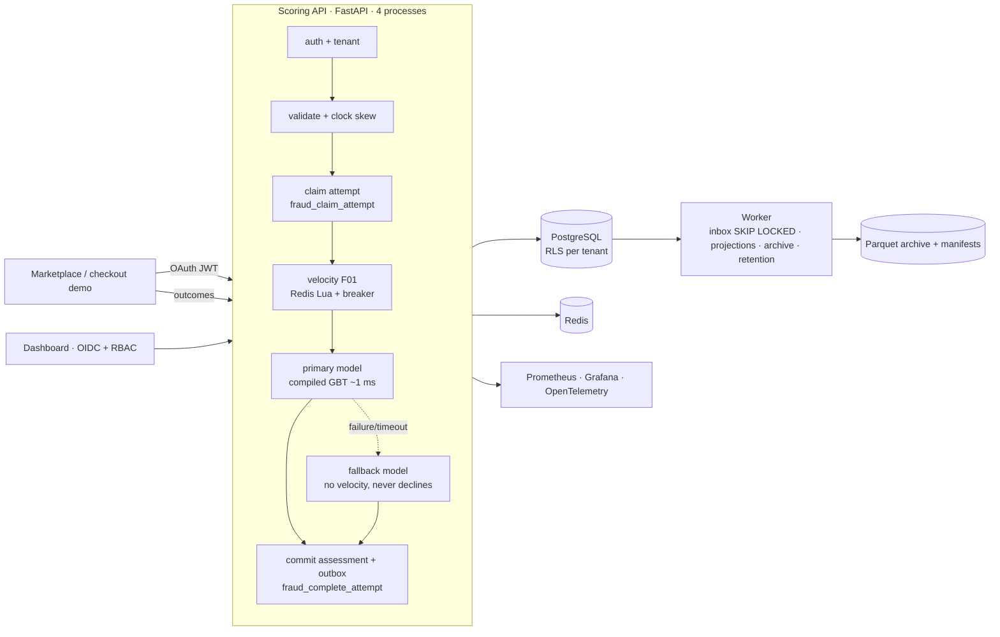

# Technical Report: Marketplace Fraud Detection Platform (v0.1)

**Status as of 2026-10-30.** This is a learning/portfolio prototype with no customers. Every
claim below is labeled **Measured** (with the evidence file), **Not achieved** (measured and
missed), or **Untested** (needs a run that has not happened, usually a cloud run awaiting
approval). Cloud spend so far: **$0**; no AWS resource has been created.

## 1. What was built

| Milestone | Scope (PRD §9) | State |
| --- | --- | --- |
| M1 | Auth, tenant identity, scoring, persisted assessment, idempotency, F01, health metrics | Built and tested |
| M2 | Outcome inbox/worker, Postgres records, archive contract, reconciliation, crash/retry, tenant isolation, privacy | Built and tested (S3 adapter written, not run against real S3) |
| M3 | IEEE-CIS audit, simulator, leakage-safe baseline, training/evaluation, versioned approved artifact, parity, deployed inference | Built; SageMaker job **written, not run** (paid) |
| M4 | Dashboard, RBAC/OIDC, checkout demo, Prometheus/Grafana/OpenTelemetry, runbooks | Built and tested |
| M5 | CI gates, manual release/deploy, load generator, fault injection, 10M accounting, 2,000 TPS | Workflows and IaC written; **local** load and chaos runs only; cloud targets **untested** |

## 2. Correctness evidence (Measured)

The test suite (`evidence/test-run.txt`) runs unit, security, contract, ML and integration tests;
the integration tests use real PostgreSQL 16 and Redis 7.

- **Auth never fails open.** Rejected: expired or not-yet-valid tokens, wrong issuer or audience,
  missing claims, untrusted keys, `alg:none`, HS256-with-public-key confusion, key-type
  mismatch, missing scope, unmapped client, and `tenant_id` in the payload.
- **Tenant isolation.** RLS is forced on every tenant table. The runtime role cannot bypass RLS,
  disable it, or write another tenant's rows. Cross-tenant reads return 404 in the API and the
  dashboard.
- **Idempotency.** Identical retries return the identical assessment. Key or attempt reuse with a
  different body is 409. Sixteen parallel duplicates produce exactly one assessment. Expired
  leases are taken over; live leases return 202.
- **F01 exactness.** Distinct tokens are counted including the current attempt; repeated tokens
  don't inflate the count; retries don't change it; the window boundary is exact at 5 minutes;
  tenants and devices are isolated; missing IDs stay missing.
- **Parity.** Offline F01 equals the Redis Lua script on a replayed simulator stream. Offline and
  serving feature vectors match within 1e-9.
- **Degradation.** A Redis error or hang and a primary-model timeout or crash degrade to
  FALLBACK. Both models failing gives an explicit 503 with no score. A missed deadline gives 504.
  Postgres down gives 503. Retries recover after an outage.
- **Durability.** Outcomes are acknowledged only after commit. Duplicate event IDs are safe and
  a reused ID with a different body is 409. A worker crash after claiming is recovered without
  double-applying. Poison events are dead-lettered after 5 attempts. An interrupted archive upload
  commits nothing and recovers. Retention purges only archived rows.
- **Model integrity.** A tampered model file, a wrong pinned manifest digest, an unapproved
  artifact, a feature-schema mismatch, or a synthetic model without demo-only approval each
  refuse startup. Same seed gives byte-identical model files.
- **Privacy.** Raw identifiers never appear in the database, logs, traces or metrics.

## 3. ML results

### 3.1 IEEE-CIS offline benchmark (Measured; `evidence/ml/ieee_benchmark.md`)

Chronological 60/20/20 split on `TransactionDT`. Thresholds were chosen on validation and applied
unchanged to test.

| Model | Test ROC-AUC | Test PR-AUC | Recall @ 0.5% FPR | Test FPR at that threshold |
| --- | --- | --- | --- | --- |
| L2 logistic baseline | 0.812 | 0.138 | 10.5% | 1.74% |
| Gradient-boosted trees | 0.885 | 0.464 | **34.5%** | 0.64% |

**Not achieved:** the initial target of 60% recall at the 0.5% FPR guardrail (PRD §4.2). The
validation-selected threshold also drifted above the guardrail on test (0.64% FPR), which shows
time-based distribution shift.

Next steps for the gap:
- train on all legitimate rows (the local run kept 25% for memory) and all 339 V columns;
- add entity-level aggregates (card/address/email histories), which are the main signal in
  strong IEEE-CIS solutions;
- tune on a larger search space;
- recalibrate thresholds on recent data to control the drift.

**This benchmark does not describe the deployed model.** Most API features, including F01, do
not exist in IEEE-CIS (`evidence/ml/ieee_dataset_card.md`, availability matrix).

### 3.2 Deployed demo model (Synthetic; `models/<version>/report.md`)

> Performance on synthetic data does not represent real-world commercial results.

| Synthetic: model | ROC-AUC | Recall @ 0.5% FPR (val threshold) | Test FPR |
| --- | --- | --- | --- |
| Primary (with F01) | 0.988 | 44.7% | 0.17% |
| Fallback (no velocity) | 0.986 | 41.0% | 0.27% |
| Logistic baseline | 0.950 | 25.3% | 0.02% |

- **Labels:** trained on *observed* labels (confirmed fraud = 1; no fraud evidence after 60 days
  = 0), as a marketplace would have them.
- **Promotion:** promoted locally as **synthetic demo-only** by `local-demo`. The owner should
  review and re-approve or deny it.

## 4. Performance (local machine only)

**Environment:** Windows 11 laptop running Docker Desktop, with **0.6 GB of 15.4 GB RAM free**
during the runs. Postgres, Redis, 4 API processes, the worker and k6 all ran on one machine. The
results describe this machine and **not** the target hardware.

| Offered rate (k6 constant arrival) | ML p95 / p99 client latency | No assessment (503/504; merchant fails open) | Reconciled |
| --- | --- | --- | --- |
| 30/s for 60 s | 38 / 126 ms | 17.6% | ✅ |
| 50/s for 60 s | 62 / 135 ms | 6.1% | ✅ |
| 100/s for 60 s | 204 ms / 1.12 s | 26% | ✅ |

A single 50/s run after the review fixes gave 63 / 119 ms and 5.8%, reconciled
(`evidence/perf/post-review-50-*.json`). It used 2 API processes rather than 4 and more free
memory, so treat it as "no sign of a regression", not as a controlled comparison.

`evidence/perf/final-r*.json`. "Reconciled" means:
- every 200 the client saw was durably recorded with the same scoring mode;
- no attempt exists that the client did not send.

Run-to-run variance was large: 30/s gave 1.3% unavailable in an earlier run. k6 also reported
negative latencies, a sign of VM clock jumps. Both point to the environment.

Optimizations made, each verified with a measurement:

| Change | Before | After |
| --- | --- | --- |
| Single-row inference | 114 ms p50 (scikit-learn, OpenMP) | 1.1 ms p50 (compiled trees, exact) |
| Archive export query | Sequential scan of all assessments per batch | Primary-key lookup; Postgres CPU 770% → 80% at 100/s |
| Archive export locking | Locks held during object writes; ML throughput 2/s under load | Locks only in a short commit; 86/s |
| Claim and commit | 4 round trips each | 1 each (server-side functions) |

**Targets:**

| PRD target | Status |
| --- | --- |
| P95 < 100 ms and P99 < 200 ms at 2,000 assessments/s | **Untested** at that rate; locally met only at ≤ 50/s and only at p95 |
| 10M unique-attempt volume run | **Untested** (needs a cloud run; reconciliation tooling exists and passes locally) |
| 99.9% primary availability over 30 days | **Untested** (no 30-day run) |

The remaining local bottleneck is per-request CPU in Python (about 10–15 ms of work across the
framework, database driver, JWT, Redis and inference) plus sporadic fsync stalls. Next steps:
- measure on Linux target hardware (EC2) before changing architecture;
- then reduce per-request overhead and use `commit_delay` group commit under concurrency.

## 5. Fault injection (local; `evidence/chaos/*.json`)

| Scenario | Expected | Result |
| --- | --- | --- |
| Redis stopped | FALLBACK assessments, never decline | Warm API: 60 of 60 FALLBACK. Freshly started API: 18–20 of 20, because the first request on a new process can miss the deadline (504). Readiness stays 200 `degraded`. The first 5 requests per process take about 100 ms before the circuit breaker opens; the rest fail fast |
| Postgres paused | Explicit 503/504, no score | Pass |
| Worker killed | Scoring unaffected; events resume | Pass |
| API stopped (merchant view) | Checkout continues to ordinary authorization | Pass functionally. 0.2 s once warm (measured directly); the first call after the outage took 0.5–1.5 s against the 200 ms budget |

## 6. Limitations and open items

- **Owner decisions:** review I-05 (API contract), I-07 (2% verify threshold), I-09
  (label precedence) and I-14 (dashboard UI and roles), all in `docs/DECISIONS.md`.
- **Never run against AWS:** SageMaker, ECR/EC2 deploy, S3 archive, GitHub Actions. Each needs
  owner approval; see `infra/aws/README.md`.
- **Local test-only identity:** the merchant token issuer and the dashboard OIDC provider are
  test-only. A managed OIDC issuer is needed for any shared deployment (I-04).
- **Model validity:** the deployed model is synthetic-only. Real-world recall is unknown.
- **Unimplemented:** pseudonymization key rotation (I-12), investigation-record retention,
  per-tenant rate limiting (`429` is in the contract but not enforced), false-decline guardrails
  (I-16).
- **Not provided:** approved Decisions 001–019, `TECHNICAL_SPEC.md` and `AGENTS.md` were never
  supplied, so the build has not been checked against them.
